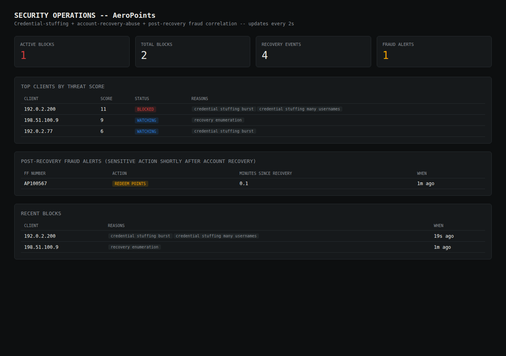

# frequent-flyer-defense (AeroPoints)

A mock airline frequent-flyer loyalty portal built to defend against the
attack pattern actually used in the 2025 Qantas and Hawaiian Airlines
breaches (publicly attributed to the "Scattered Spider" threat group):
**account-recovery / MFA-reset abuse**, not classic credential stuffing.

The real incidents didn't need a stolen password. Attackers social-engineered
or automated their way through the *recovery* flow, took over accounts that
way, and only then went after loyalty points and personal data. A login-page
rate limiter never sees that attack at all, because the attacker never
touches `/login` with a guessed password. This project's core contribution
is a detector that watches the account-recovery flow and the post-recovery
window with the same seriousness most demos reserve for login.

## What it defends against

1. **Credential stuffing** (the familiar case) -- many failed logins against
   one account in a short window, or one client trying many different
   frequent-flyer numbers. Standard defense, included for completeness.
2. **Recovery enumeration** (the actual 2025 pattern, phase 1) -- a client
   hitting `/account-recovery` for many different frequent-flyer numbers in
   a short window. This is reconnaissance: "which of these account numbers
   are real and worth attacking," and it happens *before* any password is
   ever touched.
3. **Post-recovery fraud correlation** (the actual 2025 pattern, phase 2) --
   a sensitive action (redeeming points, adding a payment method) happening
   shortly after an account-recovery event. This is the novel piece: the
   recovery itself may look legitimate, the login after it may look
   legitimate, and the redemption may look legitimate -- each step passes a
   login-page or velocity check in isolation. It's only the *sequence*,
   recovery followed by a high-value action, that is the signal. This
   doesn't block the action (a real user who just recovered their own
   account has every right to redeem points), it flags it for review,
   which is the realistic response in a real fraud operations team.

## Why this is architecturally different from a login-page defense

Most "account security" demos protect `/login` and stop there. The 2025
breaches show that's the wrong place to look if the attacker's actual entry
point is self-service recovery. This project treats recovery as a
first-class attack surface with its own enumeration detection, and adds a
correlation layer that spans *multiple* requests over a time window (up to
30 minutes) rather than scoring any single request in isolation.

## Try it

```
pip install -r requirements.txt
uvicorn app.main:app --port 8300
```

Then visit `http://127.0.0.1:8300` -- demo accounts are in
`app/data/accounts.json` (e.g. `AP100234` / see the file for the matching
demo password). The security operations dashboard is at
`/admin/dashboard`.



## Verified attack scenarios

All three were run end-to-end against a live local server (not just unit
tested) with distinct source IPs via `X-Forwarded-For`, matching how the
attack simulators in the earlier projects in this series work.

**1. Credential stuffing (single account, then a spray across accounts)**

- 6 failed logins against one account in 30s scores `credential_stuffing_burst`
  (6.0) -- watched, not yet blocked alone. A real user who mistypes their
  password 6 times shouldn't get locked out; sustained volume by itself
  isn't enough to justify blocking, which is why this signal alone stays
  under the block threshold.
- Spraying across 4+ distinct frequent-flyer numbers adds
  `credential_stuffing_many_usernames` (5.0). Combined with burst volume,
  the two signals cross the block threshold (`11.0 >= 8.0`) and the client
  is blocked with `403`.

**2. Recovery enumeration**

- Hitting `/account-recovery` for 4+ distinct frequent-flyer numbers from
  one client triggers `recovery_enumeration` (9.0 >= 8.0 threshold) --
  this signal alone is enough to block, unlike the credential-stuffing
  signals. Recovery enumeration has no legitimate high-volume equivalent
  (a real user only ever recovers *their own* account), so it doesn't need
  a second signal to justify blocking.
- Verified: requests 1-3 return `200`, request 4 returns `403`, request 5
  (now blocked) returns `429`.

**3. Post-recovery fraud correlation (the headline scenario)**

- Attacker requests recovery for a victim's account, gets the reset link
  (shown directly in the demo instead of emailed), sets a new password,
  logs in, and immediately redeems 310,500 points to a new delivery
  address -- each step returns success, but the redemption response
  includes: *"flagged for fraud review: recent account recovery."*
- Verified the corresponding true-negative case too: a legitimate user who
  recovers their account and then just *views* their account page (no
  sensitive action) triggers **zero** fraud alerts. The correlation only
  fires on redemption / payment-method changes, not on ordinary browsing,
  which is what keeps this usable for real recovered users instead of
  punishing all of them.

## An engineering tradeoff worth being honest about

`recovery_enumeration`'s weight (9.0) was deliberately set to clear the
block threshold (8.0) on its own, while the credential-stuffing signals
(6.0 and 5.0) were deliberately left needing to combine. This wasn't
arbitrary: single-signal blocking on repeated login failures against one
account creates its own denial-of-service risk (an attacker can lock a real
user out just by trying wrong passwords), whereas there's no equivalent
legitimate reason for one client to be recovering many different accounts.
The threshold design reflects that difference in false-positive cost, not
just a tuning knob turned until a test passed.

## Project layout

```
app/
  main.py               FastAPI routes, session cookies, block-gate middleware
  security/
    scoring.py           Detection signals + block-threshold logic
    store.py             In-memory client/recovery/fraud state
  data/accounts.json      Demo frequent-flyer accounts
  templates/              Portal pages + SOC-style live dashboard
```

## Limitations (demo scope)

- State is in-memory and per-process; a production system would need a
  shared store (Redis, etc.) behind multiple app instances.
- `X-Forwarded-For` is trusted unconditionally so the scenarios above can
  simulate distinct source IPs against one local process -- a real
  deployment must only trust this header from a known, trusted reverse
  proxy.
- Session tokens and password reset tokens both use `itsdangerous` signing
  for demo simplicity; a production system would want reset tokens to be
  single-use and short-lived, tracked server-side.
